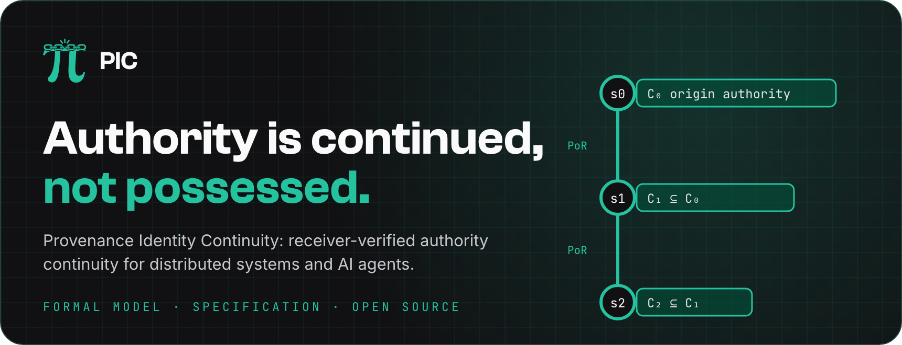
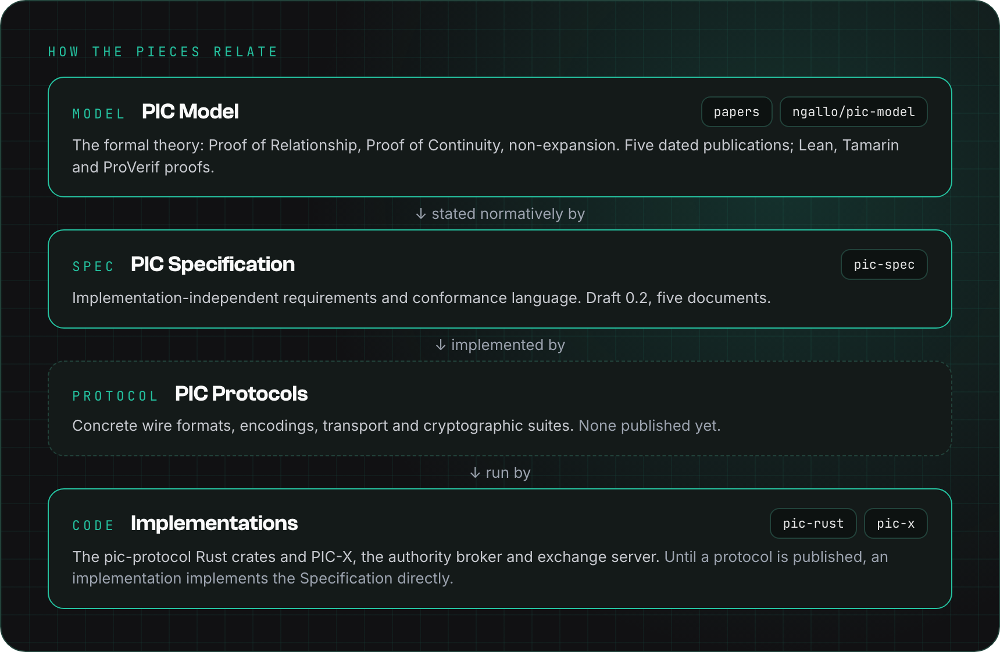

  

# pic-protocol/.github

This repository holds what the [pic-protocol](https://github.com/pic-protocol) organization shares across all its repositories: the public profile and the community health files.
GitHub uses a file from here for any repository that does not define its own.

## What is here

| Path                                       | What it is                                                                                    |
| ------------------------------------------ | --------------------------------------------------------------------------------------------- |
| [`profile/README.md`](profile/README.md)   | The organization profile shown at [github.com/pic-protocol](https://github.com/pic-protocol). |
| [`profile/assets/`](profile/assets)        | The profile figures.                                                                          |
| [`GOVERNANCE.md`](GOVERNANCE.md)           | How the PIC Spec and related PIC Protocol specifications are governed.                        |
| [`CONTRIBUTING.md`](CONTRIBUTING.md)       | How to contribute to the PIC Model, the PIC Spec and PIC Protocol documents.                  |
| [`MAINTAINERS.md`](MAINTAINERS.md)         | The scope and limits of the Maintainer role.                                                  |
| [`CODE_OF_CONDUCT.md`](CODE_OF_CONDUCT.md) | The Contributor Covenant, as applied to this project.                                         |
| [`SECURITY.md`](SECURITY.md)               | How to report a vulnerability: privately, never through a public issue.                       |
| [`LICENSE`](LICENSE)                       | Creative Commons Attribution 4.0 International.                                               |

## How the organization is laid out

  

| Repository                                                                       | Role                                                            |
| -------------------------------------------------------------------------------- | --------------------------------------------------------------- |
| [pic-spec](https://github.com/pic-protocol/pic-spec)                             | The official PIC Specification, draft 0.2.                      |
| [pic-x](https://github.com/pic-protocol/pic-x)                                   | PIC-X, the PIC Authority Broker and Exchange Server.            |
| [pic-rust](https://github.com/pic-protocol/pic-rust)                             | The Rust crates for PIC Profile 0.2.                            |
| [pic-protocol.github.io](https://github.com/pic-protocol/pic-protocol.github.io) | The source of [pic-protocol.org](https://www.pic-protocol.org). |

## Scope and authority

- PIC is defined by the **PIC Model** and the **PIC Specification**; repositories and implementations do not redefine it.
- PIC Protocol documents, when published, **implement** the PIC Specification and **must not** redefine its core invariants.
- Forks and derivative works may exist under the terms of the license, but **must not** present themselves as canonical unless the Specification Steward designates them.

In case of conflict, the license files and the normative text of the PIC Specification take precedence over this README.

## Origin and stewardship

The **Provenance Identity Continuity (PIC) Model** was originally developed by **Nicola Gallo**.
Its dated research history and primary publications are recorded in the PIC Specification, under [Origins, Authorship, and Historical Record](https://github.com/pic-protocol/pic-spec/blob/main/draft/0.2/pic-spec.md#origins-authorship-and-historical-record).
The PIC Specifications are published and maintained by **Nitro Agility S.r.l.** as Specification Steward, which also operates this organization.
Attribution and canonical-version information is summarized in the specification [NOTICE](https://github.com/pic-protocol/pic-spec/blob/main/NOTICE.md).

## License

The content of this repository is licensed under the **Creative Commons Attribution 4.0 International (CC BY 4.0)** license.
See [`LICENSE`](LICENSE) for the full terms.
